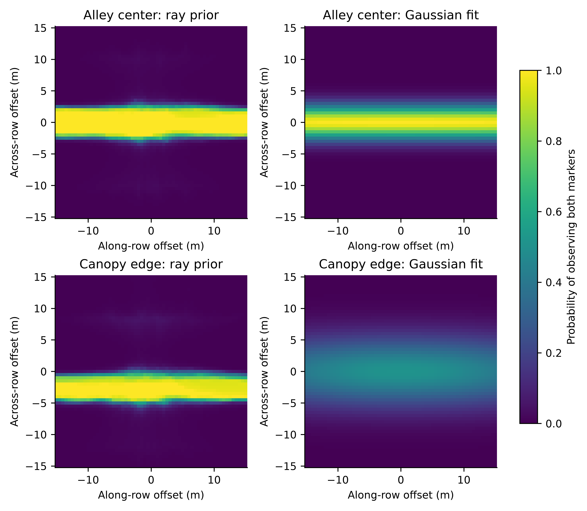
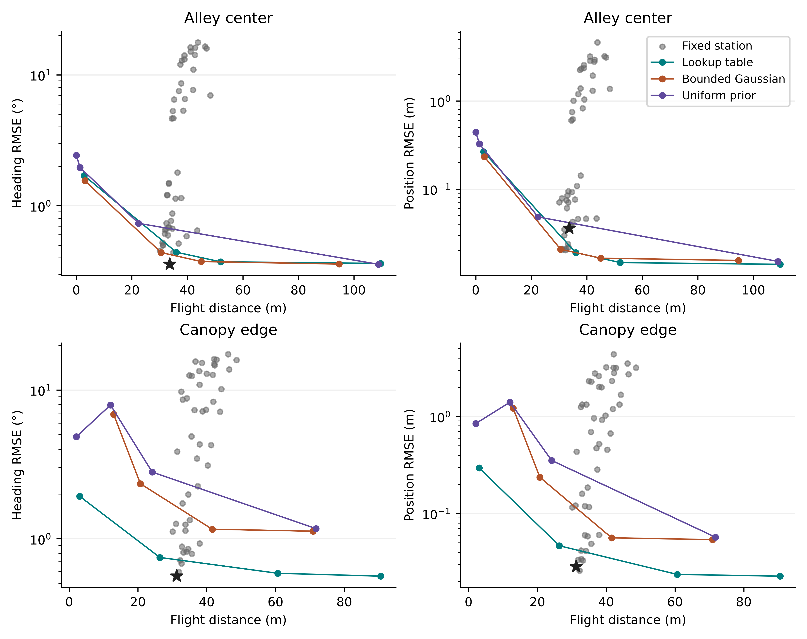

# Visibility-Aware UAV Viewpoint Selection for Ground Robot Localization in Simulated Orchards

**Chunlong Yue¹\*, Qian Li¹, Junyi Zhang¹, Kaikai Zhou¹ and Bo Peng¹**

¹ College of Energy and Intelligent Engineering, Henan University of Animal Husbandry and Economy, Zhengzhou 450046, China  
\* Correspondence: edwardyue2011@gmail.com. ORCID: 0009-0009-1272-7294.

**Abstract.** An aerial camera can help localize a ground robot under orchard canopies, provided that its viewpoint offers useful measurement geometry and a clear view of the robot. We compare fixed and adaptive viewpoints for a UAV observing two markers on a ground robot in a simulated orchard. A one-step policy combines predicted position and heading uncertainty with flight distance. Three visibility priors are evaluated against direct ray casting in 30 separately generated orchards per scenario. In the alley center, the lowest-heading-error fixed station achieved 0.359° heading and 0.036 m position RMSE over 33.7 m of flight. A lookup-table policy achieved 0.442° and 0.019 m over 36.0 m. Near the canopy edge, a fixed station tuned over distance and azimuth achieved 0.562° and 0.028 m over 31.2 m. The same lookup-table policy used 26.4 m but increased errors to 0.749° and 0.046 m. At the same motion weight, replacing the lookup table with a bounded Gaussian or uniform prior further increased both errors near the canopy edge. The simulations identify where modeling visibility affects viewpoint selection and quantify the accuracy cost of reducing flight distance relative to tuned fixed stations.

**Keywords.** UAV–UGV cooperation, bearing-only localization, active sensing, canopy occlusion, orchard robotics, GNSS denial.

**Highlights**

*What are the main findings?*

- The ray-based lookup table improved adaptive localization near the canopy edge relative to Gaussian and uniform priors at the same motion weight.
- A tuned 2 m fixed station remained competitive. The shorter lookup-table flight at the edge increased both localization errors.

*What are the implications of the main findings?*

- Fixed-station comparisons should vary both azimuth and distance under shared flight and observation constraints.
- The value of adapting the viewpoint depends on canopy geometry and the accuracy required for the ground task.

## 1. Introduction

Positioning a ground robot inside an orchard can be difficult when canopy cover degrades GNSS measurements [1]. A UAV above the canopy can supply relative observations using a camera while maintaining a navigation solution of its own. Air–ground localization methods have used relative bearings or ranges to exploit complementary viewpoints [2,3]. A related use of aerial data in orchards is to construct route maps for ground robots from photogrammetry [4]. Here the UAV moves during the ground robot's traversal to acquire observations of the vehicle itself.

For a bearing sensor, a viewpoint can produce a strong change in measured azimuth when the target rotates, yet still be unsuitable because the line of sight crosses foliage. Visibility-aware aerial trajectory optimization already treats occlusion and field of view as constraints or objectives [5]. The question considered here is narrower: how much does the representation of canopy visibility affect station selection and the accuracy–flight distance tradeoff when a single UAV observes two ground markers? A strong test requires a fixed-station baseline that can choose a short range and an oblique azimuth. It also requires generating detections independently of the planner's prior, so that a planner is evaluated on the observations its selected positions would actually yield in the simulated geometry.

We compare a lookup table, a fitted bounded Gaussian, and a constant prior using the same planner and filter. The test uses fixed orchard layouts with held-out random realizations, a ground path confined to an alley, and a speed-limited UAV. Two path offsets expose the strategies to different occlusion patterns. We report the resulting heading and position errors together with flight distance, including settings at which fixed stations are competitive.

## 2. Materials and Methods

### 2.1. State and measurement model

The ground state is $s=(x,y,\theta,b)$, where $x$ and $y$ are horizontal position, $\theta$ is heading, and $b$ is gyro bias. The planar motion model is

$$
\dot x=v\cos\theta,\quad \dot y=v\sin\theta,\quad
\dot\theta=\omega_m-b.
$$

The aerial position $u$ is assumed known. Two markers at height 0.3 m have horizontal positions $m_i=(x,y)+s_i(L/2)(\cos\theta,\sin\theta)$, with $s_i\in\{-1,1\}$ and $L=1$ m. Given a paired detection, each marker produces the horizontal azimuth $\beta_i=\operatorname{atan2}(m_{iy}-u_y,m_{ix}-u_x)+\epsilon_i$. Noise is independent Gaussian with standard deviation 0.008 rad per azimuth. The simulated camera is nadir-facing at 6 m with a circular 120° full field of view. Both markers must lie within the footprint and at least 0.35 m horizontally from the nadir point. The latter condition excludes the azimuth singularity. The filter uses no elevation or direct range observations.

Let $r_i=\lVert m_i-u\rVert$ be the horizontal marker range and $\bar\beta_i$ the noise-free azimuth. The heading derivative is

$$
\frac{\partial \bar\beta_i}{\partial\theta}
=\frac{s_i L}{2r_i}\cos(\bar\beta_i-\theta).
$$

Consequently the heading diagonal of the single-update information matrix is $F_{\theta\theta}=(L/2)^2\sum_i\cos^2(\bar\beta_i-\theta)/(\sigma_\beta^2 r_i^2)$. At large station radius $r$, the axial term scales as $r^{-2}$ and the exact lateral term as $r^{-4}$, with lateral-to-axial ratio asymptotic to $(L/2r)^2$. This diagonal describes sensitivity with position held fixed. The two-row Jacobian has rank at most two for the three pose variables, so joint estimation also uses the motion model and filter prior. An extended Kalman filter (EKF) propagates the state and uses the paired azimuths when available.

### 2.2. Canopy model and visibility priors

Tree rows run along $x$ at 4 m spacing, with 2 m spacing along each row. Tree centers are jittered horizontally with independent standard deviation 0.15 m. Each tree crown is represented by an ellipsoid with semi-axes $(1.2,1.2,1.5)$ m and center height 2 m. For each marker, the segment to the UAV is intersected with all relevant ellipsoids. With additive optical depths in overlapping crowns, the marker's transmittance is $q_i=\exp(-k\ell_i)$, where $\ell_i$ is the sum of the in-crown path lengths and $k=1$ m$^{-1}$. The model assumes detection probability equals transmittance and detections are conditionally independent given geometry. A pair is therefore available with probability $q_1q_2$ if both markers meet the camera gate, and with probability zero otherwise. A failed pair produces no measurement update.

We form a relative-offset lookup table on a 0.5 m grid over $[-15,15]^2$ m. Each grid value is the mean of $q_1q_2$ over 20 prior layouts and randomized along-row phases, with the marker pair aligned to the row. Separate tables represent nominal vehicle paths at $y=0$ m and $y=1$ m. The camera gate is evaluated separately. For the Gaussian ablation, we fit $A\exp[-(d_x/\lambda_x)^2-(d_y/\lambda_y)^2]$ to the same table by probability-space least squares, with $0\le A\le1$. The uniform ablation uses the mean of that table. Both ablations share the same camera gate. At evaluation time the observation generator uses direct ray intersections from the actual marker positions in a held-out fixed orchard. None of the three priors supplies its detections.

**Figure 1.** Pair-visibility priors before applying the camera gate. Offsets are relative to the nominal ground-robot center in row-aligned coordinates. The two scenarios have the same canopy dimensions and different nominal ground paths.

### 2.3. Adaptive and fixed-station policies

The adaptive policy replans at 1 Hz. It places 120 requested stations on 20 azimuths and six radii (2, 3, 4.5, 6.5, 9 and 12 m) about the estimated ground position. Each request is projected to the position the UAV could reach in one second at 3 m/s. The current position is also a candidate. The policy scores these reachable locations using the current state and covariance, without propagating a future ground trajectory. At each candidate it forms the conditional covariance $P^+$ of a paired update from the local bearing Jacobian and measurement noise. With pair probability $p$, the expected covariance for the two possible outcomes is $\bar P=(1-p)P+pP^+$. The score is

$$
\sqrt{\bar P_{\theta\theta}}
+0.2\sqrt{\bar P_{xx}+\bar P_{yy}}
+w\lVert u_{\rm candidate}-u_{\rm current}\rVert.
$$

The coefficient 0.2 weights horizontal position uncertainty relative to heading uncertainty. It was held constant. Each prior uses the same four motion weights $w\in\{0,0.00025,0.001,0.004\}$. These are sensitivity settings, and the simulated flight distance is an outcome rather than a hard budget.

The fixed-station family uses the same six requested radii and eight relative azimuths at 45° spacing. Zero degrees is forward, and positive azimuth is counterclockwise from the ground vehicle's estimated heading. These policies refresh their target at 1 Hz from the same estimated pose. All policies use the same initial station, speed limit, EKF, observation cadence, and camera gate. The requested radius is a waypoint parameter, so instantaneous range can differ while the UAV moves toward the target. Each 0.2 s step contributes its full horizontal displacement to the cumulative flight distance.

### 2.4. Evaluation and reproducibility

Each 50 s trial uses $x(t)=0.6t$ and $y(t)=y_0+0.22\sin(2\pi t/18)$ m. The two cases use $y_0=0$ m and $y_0=1$ m, respectively. Speed and heading are derived from the discretized path. Observations are attempted at 5 Hz. Wheel-speed noise is 3% of speed and gyro noise is 0.01 rad/s. Initial bias is drawn with standard deviation 0.01 rad/s and changes by a random walk of standard deviation $2\times10^{-5}$ rad/s per step. Initial EKF errors have standard deviations 0.20 m in each horizontal coordinate, 0.02 rad in heading, and 0.01 rad/s in bias. Every trial starts the UAV 2 m behind the ground robot's nominal initial position.

Each case uses 30 held-out layout and noise seeds. Every policy shares the same layout, odometry noise, potential bearing noise and detection draw within each seed. We evaluated 48 fixed stations and 12 adaptive configurations per case. The principal outcomes are the per-trial RMSE of wrapped heading and two-dimensional position, total horizontal flight distance, and fraction of attempts yielding a pair. Reported means give equal weight to each seed. Exploratory 95% intervals for differences use 5,000 paired bootstrap resamples of the seeds. They are conditional on the selected configurations. The best-heading fixed configuration is selected descriptively from the sweep in each case.

## 3. Results

### 3.1. Visibility prior fits

The bounded Gaussian fit to the center lookup table achieved $R^2=0.924$ with $A=1.000$, $\lambda_x=150.0$ m (the upper search bound), and $\lambda_y=2.69$ m. The edge case achieved $R^2=0.314$ with $A=0.514$, $\lambda_x=31.49$ m, and $\lambda_y=5.52$ m. The center prior was nearly constant along the alley and fell across the row. The edge prior was asymmetric about the nominal vehicle position, a feature a centered separable Gaussian cannot represent. These are fits to simulated probability maps.

### 3.2. Accuracy and flight distance

**Figure 2.** Mean errors and cumulative flight distance across 30 paired trials per point. Each gray point denotes a fixed azimuth and radius. The star marks the fixed configuration with the lowest mean heading RMSE in that scene. Colored points show the four motion weights for each prior. Connecting segments guide the eye.

**Table 1.** Selected operating points. The two LUT weights illustrate sensitivity to the flight penalty. The Gaussian and uniform rows share the motion weight 0.001 with the LUT row. The observed detection percentage is the fraction of attempts yielding both markers.

| Scenario | Policy | Heading RMSE (°) | Position RMSE (m) | Flight (m) | Pair detection (%) |
|---|---|---:|---:|---:|---:|
| Center | Fixed, forward, 2 m | 0.359 | 0.0360 | 33.7 | 99.2 |
| Center | LUT, $w=0.00025$ | 0.373 | 0.0146 | 52.0 | 94.3 |
| Center | LUT, $w=0.001$ | 0.442 | 0.0190 | 36.0 | 93.3 |
| Center | Gaussian, $w=0.001$ | 0.439 | 0.0207 | 30.6 | 96.2 |
| Center | Uniform, $w=0.001$ | 1.960 | 0.3253 | 1.3 | 26.3 |
| Edge | Fixed, 225°, 2 m | 0.562 | 0.0284 | 31.2 | 86.8 |
| Edge | Fixed, forward, 2 m | 1.131 | 0.1191 | 33.8 | 35.4 |
| Edge | LUT, $w=0.00025$ | 0.586 | 0.0236 | 60.6 | 69.6 |
| Edge | LUT, $w=0.001$ | 0.749 | 0.0465 | 26.4 | 48.8 |
| Edge | Gaussian, $w=0.001$ | 2.343 | 0.2363 | 20.7 | 14.8 |
| Edge | Uniform, $w=0.001$ | 7.925 | 1.4046 | 12.0 | 3.9 |

In the center case, the 2 m forward station had the lowest heading RMSE among tested fixed stations. At $w=0.001$, the lookup-table policy improved position RMSE by 0.0170 m and increased heading RMSE by 0.084°. Its mean flight distance was 2.35 m longer. At this weight the Gaussian alternative achieved similar mean heading and position errors with less travel than the lookup table.

At the edge, the lowest-heading-error fixed configuration changed to an oblique station on the aisle side. The lookup-table policy at $w=0.001$ flew 4.87 m less than that station, a reduction of 15.6% (paired interval for LUT minus fixed, −5.26 to −4.50 m). Its heading RMSE increased by 0.187° (0.144 to 0.230°), and position RMSE increased by 0.0181 m (0.0145 to 0.0220 m). Reducing the motion weight to 0.00025 improved the position RMSE to 0.0236 m and brought the heading RMSE to 0.586°, with flight distance increasing to 60.6 m. The fixed forward baseline performed substantially worse at the edge than the tuned oblique station. Thus a forward-only comparator would give a different picture of the gain from active sensing.

### 3.3. Visibility-prior ablation

At the edge and $w=0.001$, the lookup table gave lower heading and position errors than the Gaussian and uniform priors, with greater flight distance and a higher pair-detection fraction. For the center path at the same weight, the Gaussian gave nearly the same heading error as the lookup table while flying 5.45 m less. These comparisons share a motion penalty, and flight distances differ. Figure 2 presents the full weight sweep so that the settings can also be compared at similar distances where the measured operating points overlap.

## 4. Discussion

The simulation identifies two separate design choices: whether to adapt the viewpoint, and how to represent visibility when adapting it. A more accurate representation of the asymmetric edge prior improved localization in the adaptive comparison. The benefit was smaller in the center, where a bounded Gaussian approximated the ray prior well. The result therefore supports using a nonparametric prior when the modeled geometry produces features the Gaussian cannot represent, with the choice also depending on how far the UAV is allowed to travel.

The fixed-station sweep explains why the adaptive policy's value changes with the reference strategy. Close axial viewing is competitive near the center. Near the canopy, a close oblique station improves the chance of obtaining the marker pair. This change is available to a designer who knows which corridor the ground vehicle will follow. In the edge case, using the shorter adaptive flight trades away measurable heading and position accuracy. Whether that is acceptable depends on the ground task's tolerances. The present study evaluates localization error and travel distance, and task completion and battery use require separate measurements.

The edge and center paths are idealized and the 30 replicates vary planting jitter and sensor noise around the same nominal orchard design. The fitted and lookup priors also use that nominal design. Generalization to different row spacing, crown size, foliage density, or moving branches remains untested. The ray transmittance serves as a detection model, and the assumed conditional independence omits image-level effects shared by both markers. Camera pose and UAV position are treated as known, and the simulation excludes latency, exposure, tag decoding and aerial dynamics beyond the speed limit. The fixed configurations and motion weights are explored on the reported test cases, so a prospective deployment would need separate tuning and evaluation. The most direct validation would log both individual marker detections and ground-pose references in a real orchard while varying UAV stations near the aisle and canopy edge.

## 5. Conclusions

The relative value of a visibility-aware UAV viewpoint depends on the ground path and the comparator. The ray-based prior was most useful in the asymmetric edge scene when the planner was held fixed. A short oblique fixed station remained accurate at modest flight distance, and the tested shorter adaptive setting increased both errors. Reporting both localization errors and cumulative UAV travel, alongside a radius-and-azimuth sweep, makes that tradeoff visible in the simulated orchard.

## Data Availability Statement

The accompanying supplementary package contains the simulator, plotting code, generated priors, and seed-level outputs for all tested configurations.

## Author Contributions

Conceptualization, C.Y.; methodology, C.Y.; software, C.Y. and J.Z.; validation, Q.L. and B.P.; formal analysis, C.Y. and K.Z.; investigation, Q.L.; data curation, K.Z.; writing—original draft preparation, C.Y.; writing—review and editing, Q.L. and B.P.; visualization, J.Z.; supervision, C.Y.; funding acquisition, C.Y.

## Funding

This research was funded by the Natural Science Foundation of Henan Province, China, grant number 262300422542.

## Institutional Review Board Statement

Not applicable.

## Informed Consent Statement

Not applicable.

## Acknowledgments

The authors used OpenAI Codex for assistance with code revision, numerical checks, and manuscript drafting.

## Conflicts of Interest

The authors declare no conflicts of interest.

## References

1. Tomaštík, J.; Everett, T. Static Positioning under Tree Canopy Using Low-Cost GNSS Receivers and Adapted RTKLIB Software. *Sensors* **2023**, *23*, 3136. https://doi.org/10.3390/s23063136
2. Stegagno, P.; Cognetti, M.; Oriolo, G.; Bülthoff, H.H.; Franchi, A. Ground and Aerial Mutual Localization Using Anonymous Relative-Bearing Measurements. *IEEE Trans. Robot.* **2016**, *32*, 1133–1151. https://doi.org/10.1109/TRO.2016.2593454
3. De Silva, A.H.T.E.; Katupitiya, J. UAV-UGV Collaborative Localisation with Minimum Sensing. *Sensors* **2024**, *24*, 4629. https://doi.org/10.3390/s24144629
4. Schütte, T.; Dworak, V.; Shamshiri, R.R.; Weltzien, C. Cooperative Lane Mapping for Autonomous Mobile Robots in Horticulture by Aerial Photogrammetry. *Comput. Electron. Agric.* **2025**, *237*, 110515. https://doi.org/10.1016/j.compag.2025.110515
5. Wang, Q.; Gao, Y.; Ji, J.; Xu, C.; Gao, F. Visibility-Aware Trajectory Optimization with Application to Aerial Tracking. In *Proceedings of the IEEE/RSJ International Conference on Intelligent Robots and Systems (IROS)*, 2021, pp. 5249–5256. https://doi.org/10.1109/IROS51168.2021.9636753
