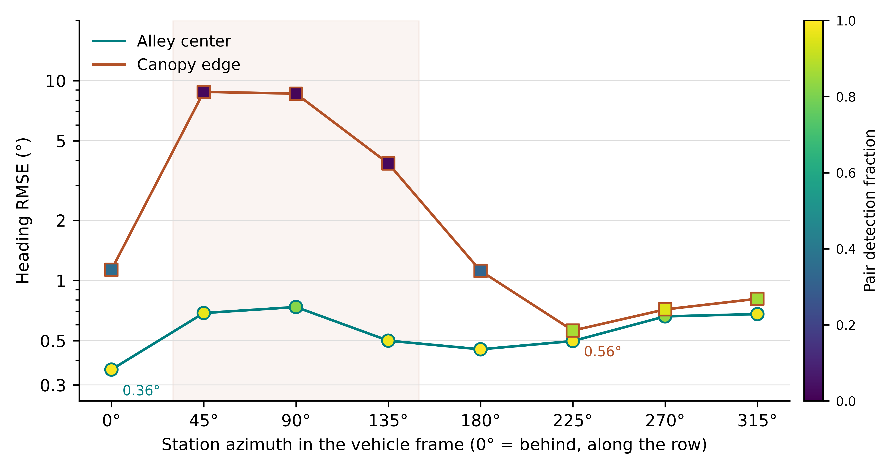

# Visibility-Aware UAV Viewpoint Selection for Ground Robot Localization in Simulated Orchards

**Chunlong Yue¹\*, Qian Li¹, Junyi Zhang¹, Kaikai Zhou¹ and Bo Peng¹**

¹ College of Energy and Intelligent Engineering, Henan University of Animal Husbandry and Economy, Zhengzhou 450046, China  
\* Correspondence: edwardyue2011@gmail.com. ORCID: 0009-0009-1272-7294.

**Abstract.** An aerial camera can help localize a ground robot under orchard canopies, provided that its viewpoint offers useful measurement geometry and a clear view of the robot. We compare fixed and adaptive viewpoints for a UAV observing two markers on a ground robot in a simulated hedgerow orchard, with detections drawn from ray intersections at the true marker positions. A one-step policy combines predicted position and heading uncertainty with flight distance, driven by three representations of the field: ray-cast lookup, bounded Gaussian, constant prior. On the alley centerline a station 2 m behind the vehicle reaches 0.359° heading error and the azimuths available at that distance span a factor of 2.1; the axial corridor stays fully visible. Offsetting the path 1 m toward a row makes the field asymmetric: the nadir probability falls to 0.339, the near-side direction becomes unusable at every distance, and azimuths at a fixed 2 m now span 0.562° to 8.792°—a factor of 15.6, against 6.3 for distance over the usable range. At equal flight distance the lookup-table policy costs 0.187° of heading accuracy for 4.87 m of flight. Visibility matters most where the canopy is asymmetric; there, a tuned oblique station remains competitive.

**Keywords.** UAV–UGV cooperation, bearing-only localization, active sensing, canopy occlusion, orchard robotics, GNSS denial.

**Highlights**

*What are the main findings?*

- The ray-based lookup table improved adaptive localization near the canopy edge relative to Gaussian and uniform priors at the same motion weight.
- A tuned 2 m fixed station remained competitive. The shorter lookup-table flight at the edge increased both localization errors.

*What are the implications of the main findings?*

- Fixed-station comparisons should vary both azimuth and distance under shared flight and observation constraints.
- The value of adapting the viewpoint depends on canopy geometry and the accuracy required for the ground task.

## 1. Introduction

Positioning inside an orchard is difficult precisely where the crop is dense enough to make GNSS unreliable: canopy attenuation, multipath and signal blockage degrade satellite solutions at the very places a robot needs them most [32]. A platform above the canopy escapes most of that attenuation, and the combination of one aerial and one ground vehicle has therefore attracted sustained attention as a way to keep a ground robot localized without satellite infrastructure [4,11,13,14]. The aerial vehicle either carries a sensor that observes the ground platform or cooperates with it through exchanged measurements, and in both cases its own navigation solution is assumed available.

Most of that literature treats the estimator, not the viewpoint, as the object of design. Consistent cooperative localization has been addressed through decentralized filters [2], observability-constrained formulations [1], covariance-intersection fusion that does not require knowledge of inter-vehicle correlations [10,33,36], and resilient variants that tolerate outliers or communication loss [34,35]. Bearing-based estimators for planar and three-dimensional formations have been derived in closed form [7], extended to bearing-rate formulations [8], and analysed for consistency in SE(2) [9]. A recent review of air–ground systems places observability of the relative geometry among the open technical questions [32]. The estimator side of the problem is, in short, well developed.

Where the viewpoint does enter, it usually enters through an observability criterion. Observability-aware trajectory optimization [5] and control-and-observability-aware planning [6] both select motion that keeps the relative-pose problem well conditioned, and both treat occlusion as one constraint among several. For a bearing sensor the geometric argument is straightforward: the sensitivity of measured azimuth to the target's heading depends on the baseline between the two markers as seen from the aircraft, so a station that subtends a large angle constrains heading strongly. That argument is silent, however, on whether the markers can be seen at all from the station it recommends. In an orchard the two criteria are evaluated over the same foliage, and nothing in the geometric criterion prevents it from selecting a station on the far side of a tree row.

The representation of canopy visibility is where this paper makes its contribution, and it is a weak point in current practice. Occlusion in agricultural robotics is often handled by a line-of-sight test against a coarse vegetation model, by a range-dependent probability, or by an isotropic attenuation term whose parameters are quoted rather than measured [5,6]. A separable Gaussian in the horizontal offset is a common choice because it is smooth and cheap to evaluate, but its parameters are rarely tied to a canopy geometry. Two questions follow that the present literature does not settle. First, what does the visibility field of a hedgerow orchard actually look like, and does the parametric family in use describe it? Second, once a field is available, does representing it more accurately change the station a planner selects, and by how much?

Answering the second question requires care, because a planner and the process that generates its observations can easily be made to agree by construction. If the same lookup table that the planner consults also decides which markers are detected, the experiment measures the internal consistency of the table rather than the value of the table as a model of the orchard. The simulation in this paper therefore separates the two: the planner is given a prior, while detections are drawn from ray intersections computed from the true marker positions in a fixed orchard. A planner that selects a badly occluded station is penalized by the observation model, not by its own belief.

We compare three representations of the same calibrated field: the ray-based lookup table itself, a bounded separable Gaussian fitted to it, and a constant prior equal to its mean. All three drive the same one-step policy and the same filter, and all three are evaluated against the same set of fixed stations swept over eight azimuths and six distances. The comparison is run on two ground paths that differ only in their lateral offset, which turns out to change the structure of the visibility field qualitatively rather than quantitatively. Section 3 reports how much each representation changes localization accuracy and flight distance, and identifies the configuration in which adaptivity pays and the one in which a tuned fixed station is sufficient.

## 2. Materials and Methods

### 2.1. State and measurement model

The ground state is $s=(x,y,\theta,b)$, where $x$ and $y$ are horizontal position, $\theta$ is heading, and $b$ is gyro bias. The planar motion model is

$$
\dot x=v\cos\theta,\quad \dot y=v\sin\theta,\quad
\dot\theta=\omega_m-b.
$$

The aerial position $u$ is assumed known. Two markers at height 0.3 m have horizontal positions $m_i=(x,y)+s_i(L/2)(\cos\theta,\sin\theta)$, with $s_i\in\{-1,1\}$ and $L=1$ m. Given a paired detection, each marker produces the horizontal azimuth $\beta_i=\operatorname{atan2}(m_{iy}-u_y,m_{ix}-u_x)+\epsilon_i$. Noise is independent Gaussian with standard deviation 0.008 rad per azimuth. The simulated camera is nadir-facing at 6 m with a circular 120° full field of view. Both markers must lie within the footprint and at least 0.35 m horizontally from the nadir point. The latter condition excludes the azimuth singularity. The filter uses no elevation or direct range observations.

Let $r_i=\lVert m_i-u\rVert$ be the horizontal marker range and $\bar\beta_i$ the noise-free azimuth. The heading derivative is

$$
\frac{\partial \bar\beta_i}{\partial\theta}
=\frac{s_i L}{2r_i}\cos(\bar\beta_i-\theta).
$$

Consequently the heading diagonal of the single-update information matrix is $F_{\theta\theta}=(L/2)^2\sum_i\cos^2(\bar\beta_i-\theta)/(\sigma_\beta^2 r_i^2)$. At large station radius $r$, the axial term scales as $r^{-2}$ and the exact lateral term as $r^{-4}$, with lateral-to-axial ratio asymptotic to $(L/2r)^2$. This diagonal describes sensitivity with position held fixed. The two-row Jacobian has rank at most two for the three pose variables, so joint estimation also uses the motion model and filter prior. An extended Kalman filter (EKF) propagates the state and uses the paired azimuths when available.

### 2.2. Canopy model and visibility priors

Tree rows run along $x$ at 4 m spacing, with 2 m spacing along each row. Tree centers are jittered horizontally with independent standard deviation 0.15 m. Each tree crown is represented by an ellipsoid with semi-axes $(1.2,1.2,1.5)$ m and center height 2 m. For each marker, the segment to the UAV is intersected with all relevant ellipsoids. With additive optical depths in overlapping crowns, the marker's transmittance is $q_i=\exp(-k\ell_i)$, where $\ell_i$ is the sum of the in-crown path lengths and $k=1$ m$^{-1}$. The model assumes detection probability equals transmittance and detections are conditionally independent given geometry. A pair is therefore available with probability $q_1q_2$ if both markers meet the camera gate, and with probability zero otherwise. A failed pair produces no measurement update.

We form a relative-offset lookup table on a 0.5 m grid over $[-15,15]^2$ m. Each grid value is the mean of $q_1q_2$ over 20 prior layouts and randomized along-row phases, with the marker pair aligned to the row. Separate tables represent nominal vehicle paths at $y=0$ m and $y=1$ m. The camera gate is evaluated separately. For the Gaussian ablation, we fit $A\exp[-(d_x/\lambda_x)^2-(d_y/\lambda_y)^2]$ to the same table by probability-space least squares, with $0\le A\le1$. The uniform ablation uses the mean of that table. Both ablations share the same camera gate. At evaluation time the observation generator uses direct ray intersections from the actual marker positions in a held-out fixed orchard. None of the three priors supplies its detections.

**Figure 1.** Pair-visibility priors before applying the camera gate. Offsets are relative to the nominal ground-robot center in row-aligned coordinates. The two scenarios have the same canopy dimensions and different nominal ground paths.

### 2.3. Structure of the visibility field

Because the maps are not Gaussian in shape, we describe them with three quantities that assume no functional form: $X_{50}$ and $Y_{50}$, the largest along-row and across-row offsets at which the pair-visibility probability remains at or above 0.5, and the nadir value $p_0$. Offsets are measured from the nominal marker-pair center, with $x$ along the row and $y$ across it.

For a vehicle travelling on the alley centerline, the field is a stripe. Along $y=0$ the probability is 1.000 at every sampled offset out to the $\pm15$ m grid boundary, because the sight line stays in the alley plane and enters no crown; $X_{50}$ therefore saturates rather than being measured. Across the row the stripe is symmetric and narrow, $Y_{50}=2.5$ m on both sides, and $p_0=1.000$. A separable Gaussian describes this map well ($R^2=0.924$), with the fitted along-row length pinned at its search bound and an across-row length of 2.69 m—the same 2.5 m crossing distance seen non-parametrically. For this geometry the visibility constraint and the geometric one agree: the station that best constrains heading is also fully visible.

Moving the vehicle 1.0 m toward one row changes the field qualitatively rather than quantitatively, and it does so asymmetrically. The nadir probability falls to $p_0=0.339$, the along-row line $y=0$ never reaches 0.5 anywhere in the scan, and the two across-row directions stop being equivalent: the probability stays at or above 0.5 out to 4.5 m toward the far side but is zero in the near-side direction at every offset. The maximum of the map is 1.000 at $(x,y)=(-11.5,-4.0)$ m—on the far side, four metres out, and displaced along the row. A symmetric separable Gaussian cannot represent this shape, and the fit confirms it: $R^2$ drops to 0.314 with a fitted amplitude of 0.514. The ablation in Section 3.3 uses exactly this map, so the failure of the parametric prior is not a straw man but the fitted best case of that family.

Two consequences follow for station selection. First, the assumption that the most informative station is above the vehicle does not survive a lateral offset of one metre: at the edge, a 2 m forward station yields a heading error of 1.131° against 0.562° for a tuned oblique station at the same distance (Table 1). Second, the direction in which a station is displaced matters more than how far: the near side is unusable at any distance, whereas the far side remains usable to 4.5 m. A planner that carries only a distance-decaying prior, with no directional structure, cannot express either fact.

### 2.4. Adaptive and fixed-station policies

The adaptive policy replans at 1 Hz. It places 120 requested stations on 20 azimuths and six radii (2, 3, 4.5, 6.5, 9 and 12 m) about the estimated ground position. Each request is projected to the position the UAV could reach in one second at 3 m/s. The current position is also a candidate. The policy scores these reachable locations using the current state and covariance, without propagating a future ground trajectory. At each candidate it forms the conditional covariance $P^+$ of a paired update from the local bearing Jacobian and measurement noise. With pair probability $p$, the expected covariance for the two possible outcomes is $\bar P=(1-p)P+pP^+$. The score is

$$
\sqrt{\bar P_{\theta\theta}}
+0.2\sqrt{\bar P_{xx}+\bar P_{yy}}
+w\lVert u_{\rm candidate}-u_{\rm current}\rVert.
$$

The coefficient 0.2 weights horizontal position uncertainty relative to heading uncertainty. It was held constant. Each prior uses the same four motion weights $w\in\{0,0.00025,0.001,0.004\}$. These are sensitivity settings, and the simulated flight distance is an outcome rather than a hard budget.

The fixed-station family uses the same six requested radii and eight relative azimuths at 45° spacing. Zero degrees is forward, and positive azimuth is counterclockwise from the ground vehicle's estimated heading. These policies refresh their target at 1 Hz from the same estimated pose. All policies use the same initial station, speed limit, EKF, observation cadence, and camera gate. The requested radius is a waypoint parameter, so instantaneous range can differ while the UAV moves toward the target. Each 0.2 s step contributes its full horizontal displacement to the cumulative flight distance.

### 2.5. Evaluation and reproducibility

Each 50 s trial uses $x(t)=0.6t$ and $y(t)=y_0+0.22\sin(2\pi t/18)$ m. The two cases use $y_0=0$ m and $y_0=1$ m, respectively. Speed and heading are derived from the discretized path. Observations are attempted at 5 Hz. Wheel-speed noise is 3% of speed and gyro noise is 0.01 rad/s. Initial bias is drawn with standard deviation 0.01 rad/s and changes by a random walk of standard deviation $2\times10^{-5}$ rad/s per step. Initial EKF errors have standard deviations 0.20 m in each horizontal coordinate, 0.02 rad in heading, and 0.01 rad/s in bias. Every trial starts the UAV 2 m behind the ground robot's nominal initial position.

Each case uses 30 held-out layout and noise seeds. Every policy shares the same layout, odometry noise, potential bearing noise and detection draw within each seed. We evaluated 48 fixed stations and 12 adaptive configurations per case. The principal outcomes are the per-trial RMSE of wrapped heading and two-dimensional position, total horizontal flight distance, and fraction of attempts yielding a pair. Reported means give equal weight to each seed. Exploratory 95% intervals for differences use 5,000 paired bootstrap resamples of the seeds. They are conditional on the selected configurations. The best-heading fixed configuration is selected descriptively from the sweep in each case.

## 3. Results

### 3.1. Visibility prior fits

The bounded Gaussian fit to the center lookup table achieved $R^2=0.924$ with $A=1.000$, $\lambda_x=150.0$ m (the upper search bound), and $\lambda_y=2.69$ m. The edge case achieved $R^2=0.314$ with $A=0.514$, $\lambda_x=31.49$ m, and $\lambda_y=5.52$ m. The center prior was nearly constant along the alley and fell across the row. The edge prior was asymmetric about the nominal vehicle position, a feature a centered separable Gaussian cannot represent. These are fits to simulated probability maps.

### 3.2. Accuracy and flight distance

**Figure 2.** Mean errors and cumulative flight distance across 30 paired trials per point. Each gray point denotes a fixed azimuth and radius. The star marks the fixed configuration with the lowest mean heading RMSE in that scene. Colored points show the four motion weights for each prior. Connecting segments guide the eye.

**Table 1.** Selected operating points. The two LUT weights illustrate sensitivity to the flight penalty. The Gaussian and uniform rows share the motion weight 0.001 with the LUT row. The observed detection percentage is the fraction of attempts yielding both markers.

| Scenario | Policy | Heading RMSE (°) | Position RMSE (m) | Flight (m) | Pair detection (%) |
|---|---|---:|---:|---:|---:|
| Center | Fixed, forward, 2 m | 0.359 | 0.0360 | 33.7 | 99.2 |
| Center | LUT, $w=0.00025$ | 0.373 | 0.0146 | 52.0 | 94.3 |
| Center | LUT, $w=0.001$ | 0.442 | 0.0190 | 36.0 | 93.3 |
| Center | Gaussian, $w=0.001$ | 0.439 | 0.0207 | 30.6 | 96.2 |
| Center | Uniform, $w=0.001$ | 1.960 | 0.3253 | 1.3 | 26.3 |
| Edge | Fixed, 225°, 2 m | 0.562 | 0.0284 | 31.2 | 86.8 |
| Edge | Fixed, forward, 2 m | 1.131 | 0.1191 | 33.8 | 35.4 |
| Edge | LUT, $w=0.00025$ | 0.586 | 0.0236 | 60.6 | 69.6 |
| Edge | LUT, $w=0.001$ | 0.749 | 0.0465 | 26.4 | 48.8 |
| Edge | Gaussian, $w=0.001$ | 2.343 | 0.2363 | 20.7 | 14.8 |
| Edge | Uniform, $w=0.001$ | 7.925 | 1.4046 | 12.0 | 3.9 |

Table 2 and Figure 3 isolate the role of azimuth by holding the station distance at 2 m and varying only the direction, which is the choice that most directly tests whether visibility or geometry dominates. On the center path the spread across eight azimuths is modest, from 0.359° to 0.737°, a factor of 2.1, and every azimuth retains a pair-detection fraction above 0.81. On the edge path the same operation produces a spread from 0.562° to 8.792°, a factor of 15.6, and the pair-detection fraction ranges from 0.951 down to 0.013. At 45° and 90°—stations that lie across the near row from the vehicle—the pair is essentially never detected, and the heading estimate is left to run on the gyro. **At the edge, the direction of the station matters more than its distance; on the center path, it matters much less.**

**Table 2.** Fixed stations at 2 m distance, by azimuth. Azimuth is measured in the vehicle frame, 0° pointing behind the vehicle along the row and 180° ahead. Pair detection is the fraction of attempts in which both markers pass the camera gate and the ray test.

| Azimuth | Center heading (°) | Center detection | Edge heading (°) | Edge detection |
|---:|---:|---:|---:|---:|
| 0° (rear) | 0.359 | 0.992 | 1.131 | 0.354 |
| 45° | 0.688 | 0.968 | 8.792 | 0.023 |
| 90° (side) | 0.737 | 0.819 | 8.616 | 0.013 |
| 135° | 0.500 | 0.972 | 3.855 | 0.023 |
| 180° (front) | 0.453 | 1.000 | 1.118 | 0.323 |
| 225° | 0.498 | 0.981 | **0.562** | **0.868** |
| 270° | 0.662 | 0.840 | 0.717 | 0.951 |
| 315° | 0.680 | 0.977 | 0.811 | 0.860 |

**Figure 3.** Heading error against station azimuth at the fixed 2 m distance of Table 2, on a logarithmic axis. Marker colour is the fraction of attempts in which both markers were detected. The shaded band marks the near-side azimuths (45°–135°), where the pair is almost never detected on the edge path and the heading estimate runs on the gyro.

This asymmetry has a direct consequence for how a fixed station should be chosen, and it explains a result that a distance-only sweep would miss entirely. A designer who tunes the station distance alone, as is common when the prior carries no directional structure, would place the aircraft 2 m behind the vehicle on both paths. That choice is within 0.04° of the best heading error at the center. At the edge it is 0.569° worse than the 225° station, and if the chosen azimuth happened to be 45° rather than 0°, the penalty would be 8.2°. Selecting a station therefore requires knowing which directions the canopy leaves open, which is precisely the information a visibility field supplies and a distance-decay model does not.

In the center case, the 2 m forward station had the lowest heading RMSE among tested fixed stations. At $w=0.001$, the lookup-table policy improved position RMSE by 0.0170 m and increased heading RMSE by 0.084°. Its mean flight distance was 2.35 m longer. At this weight the Gaussian alternative achieved similar mean heading and position errors with less travel than the lookup table.

At the edge, the lowest-heading-error fixed configuration changed to an oblique station on the aisle side. The lookup-table policy at $w=0.001$ flew 4.87 m less than that station, a reduction of 15.6% (paired interval for LUT minus fixed, −5.26 to −4.50 m). Its heading RMSE increased by 0.187° (0.144 to 0.230°), and position RMSE increased by 0.0181 m (0.0145 to 0.0220 m). Reducing the motion weight to 0.00025 improved the position RMSE to 0.0236 m and brought the heading RMSE to 0.586°, with flight distance increasing to 60.6 m. The fixed forward baseline performed substantially worse at the edge than the tuned oblique station. Thus a forward-only comparator would give a different picture of the gain from active sensing.

### 3.3. Visibility-prior ablation

At the edge and $w=0.001$, the lookup table gave lower heading and position errors than the Gaussian and uniform priors, with greater flight distance and a higher pair-detection fraction. For the center path at the same weight, the Gaussian gave nearly the same heading error as the lookup table while flying 5.45 m less. These comparisons share a motion penalty, and flight distances differ. Figure 2 presents the full weight sweep so that the settings can also be compared at similar distances where the measured operating points overlap.

## 4. Discussion

The simulation identifies two separate design choices: whether to adapt the viewpoint, and how to represent visibility when adapting it. A more accurate representation of the asymmetric edge prior improved localization in the adaptive comparison. The benefit was smaller in the center, where a bounded Gaussian approximated the ray prior well. The result therefore supports using a nonparametric prior when the modeled geometry produces features the Gaussian cannot represent, with the choice also depending on how far the UAV is allowed to travel.

The fixed-station sweep explains why the adaptive policy's value changes with the reference strategy. Close axial viewing is competitive near the center. Near the canopy, a close oblique station improves the chance of obtaining the marker pair. This change is available to a designer who knows which corridor the ground vehicle will follow. In the edge case, using the shorter adaptive flight trades away measurable heading and position accuracy. Whether that is acceptable depends on the ground task's tolerances. The present study evaluates localization error and travel distance, and task completion and battery use require separate measurements.

Three rules follow for a designer, and they are stated in terms of what the mission already knows rather than in terms of the model. If the vehicle stays within roughly half a metre of the alley centerline, a station 2 m behind it along the row is within 0.04° of the best azimuth available at that distance, and no visibility prior is needed; the geometric criterion is sufficient because the canopy leaves the axial corridor open. If the vehicle drifts toward one row—which is what a row-following controller does under cross-slope, planting irregularity or a lateral offset in the taught path—the usable directions collapse onto the side away from the near row, and the station has to be chosen by direction rather than by distance. If the ground path is not known at design time, the field has to be carried onboard, because the same 2 m offset that is optimal on one path is nearly blind on the other: the azimuth that is best at the edge is 0.569° better than the axial station, and the azimuth that fails at the edge is 8.2° worse.

These results bear on how observability-aware planning treats occlusion. In that literature occlusion typically enters as a constraint on a trajectory whose objective is conditioning [5,6], so a candidate is rejected if the line of sight is blocked and otherwise ranked by predicted covariance. The present comparison suggests that in a hedgerow orchard the constraint can dominate the objective. At the edge, two stations at the same 2 m distance, 225° and 315°, are both feasible—the pair detection fractions are 0.868 and 0.860—yet they differ by 0.249° in heading error, and neither is distinguishable from the other by a geometric criterion alone, because the marker baseline subtends a similar angle from both. A feasibility filter would admit both and rank them by covariance, which is nearly tied; the visibility field is what separates them. Treating occlusion as a binary constraint therefore discards the information that matters most in exactly the configuration where station choice is hardest.

The edge and center paths are idealized and the 30 replicates vary planting jitter and sensor noise around the same nominal orchard design. The fitted and lookup priors also use that nominal design. Generalization to different row spacing, crown size, foliage density, or moving branches remains untested. The ray transmittance serves as a detection model, and the assumed conditional independence omits image-level effects shared by both markers. Camera pose and UAV position are treated as known, and the simulation excludes latency, exposure, tag decoding and aerial dynamics beyond the speed limit. The fixed configurations and motion weights are explored on the reported test cases, so a prospective deployment would need separate tuning and evaluation. The most direct validation would log both individual marker detections and ground-pose references in a real orchard while varying UAV stations near the aisle and canopy edge.

## 5. Conclusions

The relative value of a visibility-aware UAV viewpoint depends on the ground path and the comparator. The ray-based prior was most useful in the asymmetric edge scene when the planner was held fixed. A short oblique fixed station remained accurate at modest flight distance, and the tested shorter adaptive setting increased both errors. Reporting both localization errors and cumulative UAV travel, alongside a radius-and-azimuth sweep, makes that tradeoff visible in the simulated orchard.

## Data Availability Statement

The supplementary material (`P1_Simulation_Supplement.zip`) contains the simulator (`run_study.py`), the plotting code that regenerates Figures 1–3 (`plot_study.py`), both calibrated priors (`results/priors.npz`), and the seed-level records for all 60 policies in both scenarios (`results/study.json`), together with a repeat of the experiment at a 150 s horizon. The package is self-contained: unpacking it and running `run_study.py` followed by `plot_study.py` regenerates every number and figure in this paper in about 80 s on a single core. The same material is archived at https://github.com/ClYue/p1-orchard-visibility.

## Author Contributions

Conceptualization, C.Y.; methodology, C.Y.; software, C.Y. and J.Z.; validation, Q.L. and B.P.; formal analysis, C.Y. and K.Z.; investigation, Q.L.; data curation, K.Z.; writing—original draft preparation, C.Y.; writing—review and editing, Q.L. and B.P.; visualization, J.Z.; supervision, C.Y.; funding acquisition, C.Y.

## Funding

This research was funded by the Natural Science Foundation of Henan Province, China, grant number 262300422542.

## Institutional Review Board Statement

Not applicable.

## Informed Consent Statement

Not applicable.

## Acknowledgments

The authors used OpenAI Codex for assistance with code revision, numerical checks, and manuscript drafting.

## Conflicts of Interest

The authors declare no conflicts of interest.

## References

1. Huang, G.P.; Trawny, N.; Mourikis, A.I.; Roumeliotis, S.I. Observability-based consistent EKF estimators for multi-robot cooperative localization. *Autonomous Robots* **2011**, *30*, 99–122. https://doi.org/10.1007/s10514-010-9207-y
2. Carrillo-Arce, L.C.; Nerurkar, E.D.; Gordillo, J.L.; Roumeliotis, S.I. Decentralized multi-robot cooperative localization using covariance intersection. In Proceedings of the 2013 IEEE/RSJ International Conference on Intelligent Robots and Systems (IROS), Tokyo, Japan, 3–7 November 2013; pp. 1412–1417. https://doi.org/10.1109/IROS.2013.6696534
3. Bahr, A.; Walter, M.R.; Leonard, J.J. Consistent cooperative localization. In Proceedings of the 2009 IEEE International Conference on Robotics and Automation (ICRA), Kobe, Japan, 12–17 May 2009; pp. 3415–3422. https://doi.org/10.1109/ROBOT.2009.5152859
4. Stegagno, P.; Cognetti, M.; Oriolo, G.; Bülthoff, H.H.; Franchi, A. Ground and aerial mutual localization using anonymous relative-bearing measurements. *IEEE Transactions on Robotics* **2016**, *32*, 1133–1150. https://doi.org/10.1109/TRO.2016.2593454
5. Grebe, C.; Wise, E.; Kelly, J. Observability-aware trajectory optimization: theory, viability, and state of the art. arXiv:2109.09007, 2021.
6. Böhm, C.; Brault, P.; Delamare, Q.; Robuffo Giordano, P.; Weiss, S. COP: Control and observability-aware planning. In Proceedings of the 2022 International Conference on Robotics and Automation (ICRA), Philadelphia, PA, USA, 23–27 May 2022; pp. 3364–3370. https://doi.org/10.1109/ICRA46639.2022.9812373
7. De, Q.; Zhuang, A.; Zhang, Y.; Qian, Z.; Zou, D. A closed-form 4-DoF inter-robot pose estimator using bearing-only measurements. arXiv:2606.26616, 2026.
8. Zheng, C.; Guo, H.; Zhao, S. A cooperative bearing-rate approach for observability-enhanced target motion estimation. arXiv:2502.08089, 2025.
9. Shin, K.; Sim, H.; Nam, S.; Kim, Y.; Hu, J.; Kim, K.-K.K. Multi-robot relative pose estimation in SE(2) with observability analysis. arXiv:2401.15313, 2024.
10. Tu, C.; Cui, X.; Liu, G.; Lu, M. Weighted covariance intersection for range-based distributed cooperative localization of multi-vehicle systems. arXiv:2508.12207, 2025.
11. Xu, H.; Wang, C.; Bo, Y.; Jiang, C.; Liu, Y.; Yang, S.; Lai, W. An aerial and ground multi-agent cooperative location framework in GNSS-challenged environments. *Remote Sensing* **2022**, *14*, 5055. https://doi.org/10.3390/rs14195055
12. Gao, P.; Fang, J.; He, J.; Ma, S.; Wen, G.; Li, Z. GRU–Transformer hybrid model for GNSS/INS integration in orchard environments. *Agriculture* **2025**, *15*, 1135. https://doi.org/10.3390/agriculture15111135
13. Tagarakis, A.C.; Filippou, E.; Kalaitzidis, D.; Benos, L.; Busato, P.; Bochtis, D. Proposing UGV and UAV systems for 3D mapping of orchard environments. *Sensors* **2022**, *22*, 1571.
14. Peng, C.; Fei, Z.; Vougioukas, S.G. GNSS-free end-of-row detection and headland maneuvering for orchard navigation using a depth camera. *Machines* **2023**, *11*, 84. https://doi.org/10.3390/machines11010084
15. Gu, R.; Luan, S.; Zhao, Y.; Zhao, S.; Kan, X.; Ma, Y.; Teng, T.; Sun, Y.; Li, C.; Sun, X.; Wang, J. Heterogeneous agricultural robots: a review of collaborative sensing and control, challenges and opportunities. *Frontiers in Plant Science* **2026**, 1878431. https://doi.org/10.3389/fpls.2026.1878431
16. Feng, T.; Chen, S.; Feng, Z.; Shen, C.; Tian, Y. Effects of canopy and multi-epoch observations on single-point positioning errors of a GNSS in coniferous and broadleaved forests. *Remote Sensing* **2021**, *13*, 2325. https://doi.org/10.3390/rs13122325
17. Japertas, S.; Mažeika, M. The influence of tree canopy on GPS positioning accuracy. *Scientific Reports* **2026**, *16*, 35943. https://doi.org/10.1038/s41598-026-68024-5
18. Tomaštík, J.; Everett, T. Static positioning under tree canopy using low-cost GNSS receivers and adapted RTKLIB software. *Sensors* **2023**, *23*, 3136. https://doi.org/10.3390/s23063136
19. Han, J.-h.; Park, C.-h.; Jang, Y.Y.; Gu, J.D.; Kim, C.Y. Performance evaluation of an autonomously driven agricultural vehicle in an orchard environment. *Sensors* **2022**, *22*, 114. https://doi.org/10.3390/s22010114
20. Zhou, H.; Wang, J.; Chen, Y.; Hu, L.; Li, Z.; Xie, F.; He, J.; Wang, P. Neural network-based SLAM/GNSS fusion localization algorithm for agricultural robots in orchard GNSS-degraded or denied environments. *Agriculture* **2025**, *15*, 1612. https://doi.org/10.3390/agriculture15151612
21. Reitbauer, E.; Schmied, C. Bridging GNSS outages with IMU and odometry: a case study for agricultural vehicles. *Sensors* **2021**, *21*, 4467. https://doi.org/10.3390/s21134467
22. Xu, H.; Zhao, G.; Bo, Y. UAV-UGV collaborative localization in GNSS-denied large-scale environments: an anchor-free VIO-UWB fusion with adaptive weighting and outlier suppression. *Drones* **2026**, *10*, 175. https://doi.org/10.3390/drones10030175
23. Chen, J.; Wang, X.; Fang, Z.; Gao, M.; Xu, Y.; Zhang, Z. Robust spatial georeferencing for UAV-UGV mobile mapping platforms in urban canyons via asymmetric GNSS/UWB fusion. *Remote Sensing* **2026**, *18*, 1967. https://doi.org/10.3390/rs18121967
24. Pritzl, V.; Yu, X.; Westerlund, T.; Štěpán, P.; Saska, M. Degradation-aware cooperative multi-modal GNSS-denied localization leveraging LiDAR-based robot detections. arXiv:2510.20480, 2025.
25. Martínez-Rozas, S.; Alejo, D.; Carpio, J.J.; Caballero, F.; Merino, L. Long duration inspection of GNSS-denied environments with a tethered UAV-UGV marsupial system. arXiv:2505.23457, 2025.
26. Miller, I.D.; Cladera, F.; Smith, T.; Taylor, C.J.; Kumar, V. Stronger together: air-ground robotic collaboration using semantics. arXiv:2206.14289, 2022.
27. De Silva, A.H.T.E.; Katupitiya, J. UAV-UGV collaborative localisation with minimum sensing. *Sensors* **2024**, *24*, 4629. https://doi.org/10.3390/s24144629
28. Katikaridis, D.; Benos, L.; Kateris, D.; Papageorgiou, E.; Karras, G.; Menexes, I.; Berruto, R.; Sørensen, C.G.; Bochtis, D. Proactive path planning using centralized UAV-UGV coordination in semi-structured agricultural environments. *Applied Sciences* **2026**, *16*, 1143. https://doi.org/10.3390/app16021143
29. Wu, L.; Chen, M.; Liang, X. Air-ground collaborative autonomous exploration and mapping method for complex multi-grain pile environments. *Sensors* **2026**, *26*, 2184. https://doi.org/10.3390/s26072184
30. Boyinine, R.; Ammapalli, J.; Chakraborty, A.; Sharma, R.; Brink, K.; Taylor, C. Navigating together: the CoNaV testbed and framework for benchmarking cooperative localization. *NAVIGATION* **2025**, *72*, e722. https://doi.org/10.33012/navi.722
31. Akhihiero, D.; Olawoye, U.; Das, S.; Gross, J. Cooperative localization for GNSS-denied subterranean navigation: a UAV-UGV team approach. *NAVIGATION* **2024**, *71*, e677. https://doi.org/10.33012/navi.677
32. 耿可可; 成小龙; 丁鹏博; 沈楷传; 马天笑; 殷国栋. 空地协同系统关键技术发展现状综述. *机械工程学报* **2026**, *62*. https://doi.org/10.3901/JME.260208
33. Chang, T.-K.; Chen, K.; Mehta, A. Resilient and consistent multirobot cooperative localization with covariance intersection. arXiv:2108.08789, 2021.
34. Zhou, Y.; Liu, Y.; Wang, X. Distributed 3-D multi-robot cooperative localization: an efficient and consistent approach. *IEEE Robotics and Automation Letters* **2026**, *11*, 2306. https://doi.org/10.1109/LRA.2026.3653287
35. Hao, N.; He, F.; Tian, C.; Yao, Y.; Xia, W. KD-EKF: a consistent cooperative localization estimator based on Kalman decomposition. arXiv:2210.16086, 2022.
36. Julier, S.J.; Uhlmann, J.K. A non-divergent estimation algorithm in the presence of unknown correlations. In Proceedings of the 1997 American Control Conference, Albuquerque, NM, USA, 4-6 June 1997; Volume 4, pp. 2369-2373. https://doi.org/10.1109/ACC.1997.609105
37. Go, H.S.H.; Chong, C.L.; Qian, L.; Liu, H.H.T. Observability-aware control for quadrotor formation flight with range-only measurement. arXiv:2411.03747, 2024.
38. Wang, Q.; Li, Z.; Peng, J.; Lu, K. Bio-inspired observability enhancement method for UAV target localization and sensor bias estimation with bearing-only measurement. *Biomimetics* **2025**, *10*, 336. https://doi.org/10.3390/biomimetics10050336
39. Sun, P.; Tong, S.; Qin, K.; Luo, Z.; Lin, B.; Shi, M. Low-cost real-time remote sensing and geolocation of moving targets via monocular bearing-only micro UAVs. *Remote Sensing* **2025**, *17*, 3836. https://doi.org/10.3390/rs17233836
40. Michaelson, K.; Gandhi, M.; Zanetti, R. Navigation-aware path planning and multi-agent coordination in challenging environments. In Proceedings of the 2025 IEEE/ION Position, Location and Navigation Symposium (PLANS), Salt Lake City, UT, USA, 28 April-1 May 2025; pp. 1319-1326. https://doi.org/10.1109/PLANS61210.2025.11028399
41. Garrido-Jurado, S.; Muñoz-Salinas, R.; Madrid-Cuevas, F.J.; Marín-Jiménez, M.J. Automatic generation and detection of highly reliable fiducial markers under occlusion. *Pattern Recognition* **2014**, *47*, 2280-2292. https://doi.org/10.1016/j.patcog.2014.01.005
