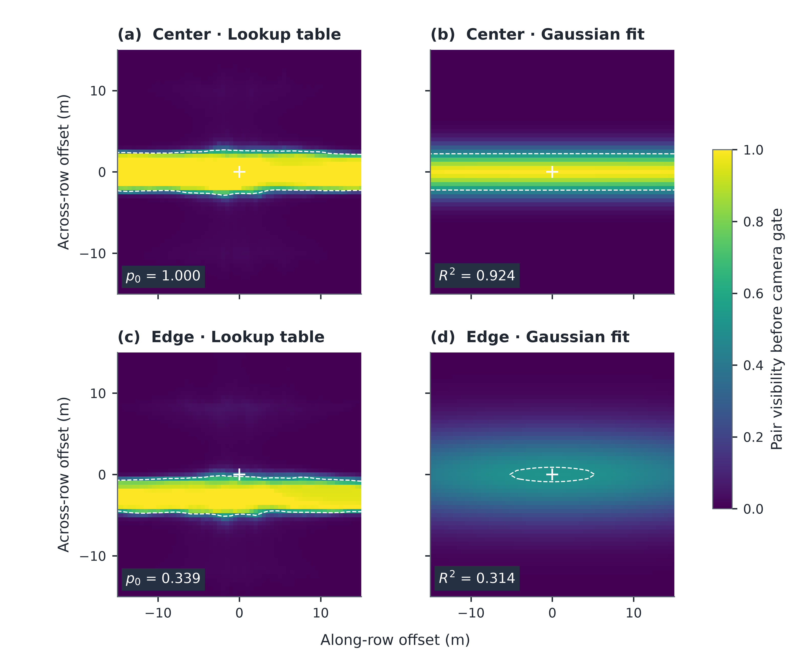
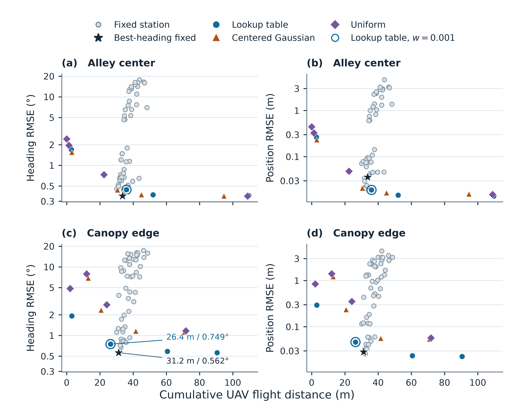
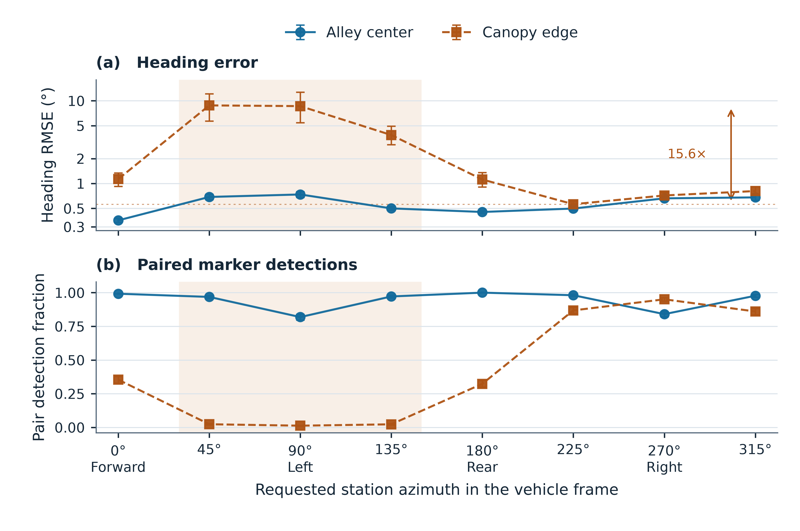
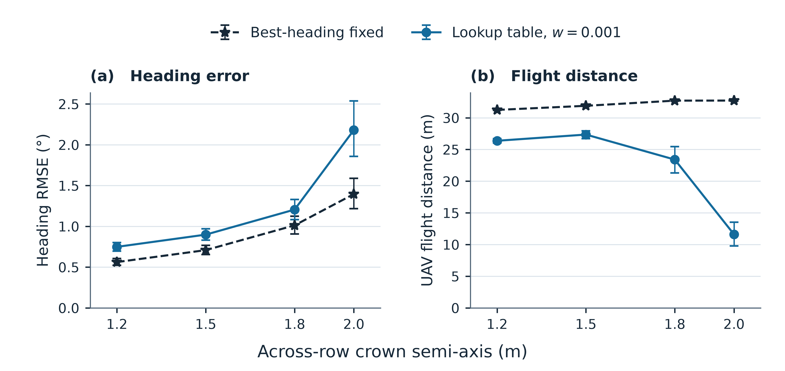

# Canopy Visibility Constrains UAV Viewpoint Selection: A Simulation Study in Orchards

**Chunlong Yue¹\*, Qian Li¹**

¹ College of Energy and Intelligent Engineering, Henan University of Animal Husbandry and Economy, Zhengzhou 450000, China  
\* Correspondence: ycl@hnuahe.edu.cn. ORCID: 0009-0009-1272-7294.

**Abstract.** An aerial camera can help localize a ground robot in an orchard if the canopy leaves both markers visible. We compared fixed and adaptive UAV viewpoints in a simulated hedgerow orchard using paired detections generated by ray intersections at the true marker positions. The adaptive planner used a lookup table, a bounded Gaussian, or a uniform visibility prior. At a requested distance of 2 m, heading root mean square error (RMSE) ranged from 0.359° to 0.737° across azimuths for the centerline path. With the path offset 1 m toward the canopy, the range widened to 0.562°–8.792°, and near-side stations yielded paired detections in only 1.3–2.3% of attempts. In that scene, the selected lookup-table setting reduced mean flight distance from 31.2 m to 26.4 m relative to the fixed station with the lowest heading RMSE, while increasing heading RMSE from 0.562° to 0.749°. A crown-width sweep at the same motion weight showed a similar tradeoff across all four tested widths. The results show when direction-dependent visibility affects viewpoint selection and quantify the cost in localization accuracy of reducing UAV travel.

**Keywords.** UAV–UGV cooperation, bearing-only localization, active sensing, canopy occlusion, orchard robotics, GNSS denial.

**Highlights**

*What are the main findings?*

- Near-side viewpoints yielded few paired detections on the offset path.
- A tuned oblique station gave the lowest fixed-station heading error at the edge.

*What are the implications of the main findings?*

- Station comparisons should sweep azimuth as well as distance.
- UAV travel and both localization errors inform the choice of station policy.

## 1. Introduction

Positioning inside an orchard is difficult precisely where the crop is dense enough to make GNSS unreliable: canopy attenuation, multipath and signal blockage degrade satellite solutions, with canopy density closely related to positioning accuracy [1,2,3], while multi-epoch observations reduce but do not remove the error [1]. Autonomous orchard vehicles therefore rely on sensor fusion rather than on GNSS alone [4,5]. Propagating through outages with inertial and odometric measurements [6,7] extends coverage but does not restore the absolute reference that has been lost, which is why recent reviews continue to identify localization in difficult environments as a challenge for agricultural robots [8] and as a key technology area for air–ground systems [9]. A platform above the canopy escapes most of that attenuation, and the combination of one aerial and one ground vehicle has therefore attracted sustained attention as a way to keep a ground robot localized without satellite infrastructure [10,11]. Related orchard systems combine aerial and ground platforms for mapping [12], or rely on onboard depth sensing for GNSS-free navigation inside rows [13]. The aerial vehicle either carries a sensor that observes the ground platform or cooperates with it through exchanged measurements, and in both cases its own navigation solution is assumed available.

Most of that literature treats the estimator, not the viewpoint, as the object of design. Consistent cooperative localization has been addressed through decentralized filters [14], observability-constrained formulations [15], covariance-intersection fusion that does not require knowledge of inter-vehicle correlations [16,17,18], distributed three-dimensional formulations that preserve observability consistency [19,20], and resilient variants that tolerate outliers and communication loss [17]. Bearing-based estimators for planar and three-dimensional formations have been derived in closed form [21], extended to bearing-rate formulations [22], and analyzed for consistency in SE(2) [23]. Air–ground teams have been demonstrated with mutual bearing observations [10], with UAV-to-UGV ranging [24], with degradation-aware multimodal fusion [25], with tethered platforms for long-duration operation [26], in large GNSS-denied test areas [27], and for mobile mapping in urban canyons [28]. Related lines cover exploration and mapping with heterogeneous teams [29,30], benchmark testbeds for cooperative localization [31], coordinated task scheduling between ground and aerial platforms [32], and localization where no absolute reference exists at all [33]. Consistency of such filters has been treated in the cooperative setting [34] as well as in the bearing-only case [23]. The estimator side of the problem is, in short, well developed.

Observability-aware trajectory optimization and control-aware planning address the conditioning of state estimation during robot motion [35,36,37,38]. Visibility-aware aerial tracking has also used continuous costs that account for viewing angle, distance, and occlusion [39]. Navigation-aware planning extends related ideas to coordination across agents [40], and low-cost aerial sensing studies describe practical bearing observations [41]. For the two-marker geometry studied here, the heading sensitivity of a bearing depends on both the marker range and the relative azimuth. Whether the measurement is available also depends on how much canopy the ray intersects.

We examine how the representation of canopy visibility affects viewpoint selection for paired marker observations. A centered separable Gaussian provides a compact, smooth approximation. A lookup table can capture directional features of the ray-based field. We ask how well the two representations describe the field and how their differences affect localization error and UAV travel under the same planning rule.

Answering the second question requires care, because a planner and the process that generates its observations can easily be made to agree by construction. If the same lookup table that the planner consults also decides which markers are detected, the experiment measures the internal consistency of the table rather than the value of the table as a model of the orchard. The simulation in this paper therefore separates the two: the planner is given a prior, while detections are drawn from ray intersections computed from the true marker positions in a fixed orchard. A planner that selects a badly occluded station is penalized by the observation model, not by its own belief.

We compare three representations of the same calibrated field: the ray-based lookup table itself, a bounded separable Gaussian fitted to it, and a constant prior equal to its mean. All three drive the same one-step policy and the same filter, and all three are evaluated against the same set of fixed stations swept over eight azimuths and six distances. The comparison is run on two ground paths that differ only in their lateral offset, which turns out to change the structure of the visibility field qualitatively rather than quantitatively. Section 3 reports how much each representation changes localization accuracy and flight distance, and identifies the configuration in which adaptivity pays and the one in which a tuned fixed station is sufficient.

## 2. Materials and Methods

### 2.1. State and measurement model

The ground state is $s=(x,y,\theta,b)$, where $x$ and $y$ are horizontal position, $\theta$ is heading, and $b$ is gyro bias. The planar motion model is

$$
\dot x=v\cos\theta,\quad \dot y=v\sin\theta,\quad
\dot\theta=\omega_m-b.
$$

The aerial position $u$ is assumed known. Two fiducial markers of the kind generated and detected by standard square-marker libraries [42] are mounted at height 0.3 m, with horizontal positions $m_i=(x,y)+s_i(L/2)(\cos\theta,\sin\theta)$, where $s_i\in\{-1,1\}$ and $L=1$ m. Given a paired detection, each marker produces the horizontal azimuth $\beta_i=\operatorname{atan2}(m_{iy}-u_y,m_{ix}-u_x)+\epsilon_i$. Noise is independent Gaussian with standard deviation 0.008 rad per azimuth. The simulated camera is nadir-facing at 6 m with a circular 120° full field of view. Both markers must lie within the footprint and at least 0.35 m horizontally from the nadir point. The latter condition excludes the azimuth singularity. The filter uses no elevation or direct range observations.

Let $r_i=\lVert m_i-u\rVert$ be the horizontal marker range and $\bar\beta_i$ the noise-free azimuth. The heading derivative is

$$
\frac{\partial \bar\beta_i}{\partial\theta}
=\frac{s_i L}{2r_i}\cos(\bar\beta_i-\theta).
$$

Consequently the heading diagonal of the single-update information matrix is $F_{\theta\theta}=(L/2)^2\sum_i\cos^2(\bar\beta_i-\theta)/(\sigma_\beta^2 r_i^2)$. At large station radius $r$, the axial term scales as $r^{-2}$ and the exact lateral term as $r^{-4}$, with lateral-to-axial ratio asymptotic to $(L/2r)^2$. This diagonal describes sensitivity with position held fixed. The two-row Jacobian has rank at most two for the three pose variables, so joint estimation also uses the motion model and filter prior. An extended Kalman filter (EKF) propagates the state and uses the paired azimuths when available.

### 2.2. Canopy model and visibility priors

Tree rows run along $x$ at 4 m spacing, with 2 m spacing along each row. Tree centers are jittered horizontally with independent standard deviation 0.15 m. Each tree crown is represented by an ellipsoid with semi-axes $(1.2,1.2,1.5)$ m and center height 2 m. For each marker, the segment to the UAV is intersected with all relevant ellipsoids. With additive optical depths in overlapping crowns, the marker's transmittance is $q_i=\exp(-k\ell_i)$, where $\ell_i$ is the sum of the in-crown path lengths and $k=1$ m$^{-1}$. The model assumes detection probability equals transmittance and detections are conditionally independent given geometry. A pair is therefore available with probability $q_1q_2$ if both markers meet the camera gate, and with probability zero otherwise. A failed pair produces no measurement update. Figure S1 sketches the plan view of the two tree rows and the across-row ray geometry for the near-side and far-side stations.

We form a relative-offset lookup table on a 0.5 m grid over $[-15,15]^2$ m. Each grid value is the mean of $q_1q_2$ over 20 prior layouts and randomized along-row phases, with the marker pair aligned to the row. Separate tables represent nominal vehicle paths at $y=0$ m and $y=1$ m. The planner was supplied with the table matching the nominal path offset and crown width of its scenario, whereas evaluation used independent orchard realizations with the same nominal parameters. The camera gate is evaluated separately. For the Gaussian ablation, we fit $A\exp[-(d_x/\lambda_x)^2-(d_y/\lambda_y)^2]$ to the same table by probability-space least squares, with $0\le A\le1$ and each scale searched on a log-spaced grid from 0.5 to 150 m (96 values). The uniform ablation uses the mean of that table. Both ablations share the same camera gate. At evaluation time the observation generator uses direct ray intersections from the actual marker positions in a held-out fixed orchard. None of the three priors supplies its detections.

{width=6.15in}

**Figure 1.** Visibility of the marker pair in the alley center (a,b) and near the canopy edge (c,d), before applying the camera gate. The left panels show the ray-based lookup tables. The right panels show the corresponding bounded, centered Gaussian fits. Offsets are measured from the nominal center of the marker pair. The cross marks zero horizontal offset, and the dashed contour marks pair visibility of 0.5. In (c) the double-headed arrow runs from the marker-pair center to the across-row offset with the highest pair visibility, and the dashed line in (d) repeats that offset on the Gaussian fit. The labels report the lookup-table value at zero offset ($p_0$) and goodness of fit ($R^2$).

### 2.3. Structure of the visibility field

Because the maps are not Gaussian in shape, we describe them with three quantities that assume no functional form: $X_{50}$ and $Y_{50}$, the largest along-row and across-row offsets at which the pair-visibility probability remains at or above 0.5, and the nadir value $p_0$. Offsets are measured from the nominal marker-pair center, with $x$ along the row and $y$ across it.

For a vehicle on the nominal centerline in the baseline crown geometry ($b=1.2$ m), pair visibility is 1.000 along the row at every sampled offset through the ±15 m grid boundary. The across-row half-visibility distance is 2.5 m on each side and $p_0=1.000$. The bounded Gaussian fit gives $R^2=0.924$, with the along-row scale at the upper search bound and an across-row scale of 2.69 m. These descriptors are evaluated before the camera gate.

Moving the nominal path 1.0 m toward a row makes the field asymmetric. At zero horizontal offset, pair visibility falls to $p_0=0.339$. The along-row profile remains below 0.5 throughout the scan. Along the across-row profile, the far side remains at or above 0.5 out to 4.5 m, whereas the highest value on the sampled near side is 0.101. A centered separable Gaussian represents neither the displacement of the high-visibility band nor the near-side and far-side asymmetry. Its fit gives $R^2=0.314$ and amplitude 0.514.

Widening the across-row semi-axis from 1.2 to 2.0 m reduced zero-offset pair visibility from 1.000 to 0.743 on the centerline and from 0.339 to 0.018 on the offset path. The centerline across-row half-visibility distance shrank from 2.5 to 0.5 m. On the offset path, the far-side distance was 4.5 m at $b=1.2$ m, and the field remained below 0.5 throughout the scanned grid at $b=2.0$ m. Section 3.4 reports how the localization and flight results changed across these widths.

The 2 m forward station and the 2 m oblique station at 225° therefore serve as a direct comparison of viewpoints at the same requested radius. The observed differences combine changes in measurement geometry with changes in paired detection availability.

### 2.4. Adaptive and fixed-station policies

The adaptive policy replans at 1 Hz. It places 120 requested stations on 20 azimuths and six radii (2, 3, 4.5, 6.5, 9 and 12 m) about the estimated ground position. Each request is projected to the position the UAV could reach in one second at 3 m/s. The current position is also a candidate. The policy scores these reachable locations using the current state and covariance, without propagating a future ground trajectory. At each candidate it forms the conditional covariance $P^+$ of a paired update from the local bearing Jacobian and measurement noise. With pair probability $p$, the expected covariance for the two possible outcomes is $\bar P=(1-p)P+pP^+$. The score is

$$
\sqrt{\bar P_{\theta\theta}} + 0.2\sqrt{\bar P_{xx}+\bar P_{yy}} + w\,\|u_{\mathrm{candidate}}-u_{\mathrm{current}}\|
$$

The coefficient 0.2 weights horizontal position uncertainty relative to heading uncertainty. It was held constant. Each prior uses the same four motion weights $w\in\{0,0.00025,0.001,0.004\}$. These are sensitivity settings, and the simulated flight distance is an outcome rather than a hard budget.

The fixed-station family uses the same six requested radii and eight relative azimuths at 45° spacing. Zero degrees is forward, and positive azimuth is counterclockwise from the ground vehicle's estimated heading. These policies refresh their target at 1 Hz from the same estimated pose. All policies use the same initial station, speed limit, EKF, observation cadence, and camera gate. The requested radius is a waypoint parameter, so instantaneous range can differ while the UAV moves toward the target. Each 0.2 s step contributes its full horizontal displacement to the cumulative flight distance.

### 2.5. Evaluation and reproducibility

Each 50 s trial uses $x(t)=0.6t$ and $y(t)=y_0+0.22\sin(2\pi t/18)$ m. The two cases use $y_0=0$ m and $y_0=1$ m, respectively. The 50 s horizon covers 30 m of along-row travel. An additional 150 s run covers 90 m and uses longer tree rows. Extending the row generator also changes the realized layouts, so this comparison assesses performance in a longer scenario. Speed and heading are derived from the discretized path. Observations are attempted at 5 Hz. Wheel-speed noise is 3% of speed and gyro noise is 0.01 rad/s. Initial bias is drawn with standard deviation 0.01 rad/s and changes by a random walk of standard deviation $2\times10^{-5}$ rad/s per step. Initial EKF errors have standard deviations 0.20 m in each horizontal coordinate, 0.02 rad in heading, and 0.01 rad/s in bias. Every trial starts the UAV 2 m behind the ground robot's nominal initial position.

Each case uses 30 held-out layout and noise seeds. Every policy shares the same layout, odometry noise, potential bearing noise and detection draw within each seed. We evaluated 48 fixed stations and 12 adaptive configurations per case. The principal outcomes are the per-trial RMSE of wrapped heading and two-dimensional position, total horizontal flight distance, and fraction of attempts yielding a pair. Reported means give equal weight to each seed. Exploratory 95% intervals for differences use 5,000 paired bootstrap resamples of the seeds. They are conditional on the selected configurations. The best-heading fixed configuration is selected descriptively from the sweep in each case. For Figure 3, pointwise 95% intervals for the mean were calculated by percentile bootstrap with 5,000 resamples of the 30 trial seeds. To assess crown-width sensitivity, we repeated the 50 s study at across-row semi-axes of 1.5, 1.8, and 2.0 m, in addition to the 1.2 m main case. At each width we compared the lowest-heading-error fixed configuration with the LUT at the common motion weight $w=0.001$.

## 3. Results

### 3.1. Visibility prior fits

The bounded Gaussian fit to the center lookup table achieved $R^2=0.924$ with $A=1.000$, $\lambda_x=150.0$ m (the upper search bound), and $\lambda_y=2.69$ m. The edge case achieved $R^2=0.314$ with $A=0.514$, $\lambda_x=31.49$ m, and $\lambda_y=5.52$ m. The center prior was nearly constant along the alley and fell across the row. The edge prior was asymmetric about the nominal vehicle position, a feature a centered separable Gaussian cannot represent. These are fits to simulated probability maps.

### 3.2. Accuracy and flight distance

{width=6.15in}

**Figure 2.** Localization error and UAV flight distance across 30 simulated trials per configuration. Panels (a,b) show the alley center and panels (c,d) the canopy edge. Gray points represent 48 fixed stations per scene. The star identifies the fixed station with the lowest mean heading RMSE. The colored markers show the four motion weights tested for each adaptive prior, and the open ring identifies the lookup-table setting at $w=0.001$. Panel (c) labels the two operating points compared in the abstract. The vertical axes are logarithmic. Flight distance is the observed cumulative distance for each configuration.

**Table 1.** Selected operating points. The two LUT weights illustrate sensitivity to the flight penalty. The Gaussian and uniform rows share the motion weight 0.001 with the LUT row. The observed pair detection is the fraction of attempts yielding both markers.

| Scenario | Policy | Heading RMSE (°) | Position RMSE (m) | Flight (m) | Pair detection |
|---|---|---:|---:|---:|---:|
| Center | Fixed, forward, 2 m | 0.359 | 0.0360 | 33.7 | 0.992 |
| Center | LUT, $w=0.00025$ | 0.373 | 0.0146 | 52.0 | 0.943 |
| Center | LUT, $w=0.001$ | 0.442 | 0.0190 | 36.0 | 0.933 |
| Center | Gaussian, $w=0.001$ | 0.439 | 0.0207 | 30.6 | 0.962 |
| Center | Uniform, $w=0.001$ | 1.960 | 0.3253 | 1.3 | 0.263 |
| Edge | Fixed, 225°, 2 m | 0.562 | 0.0284 | 31.2 | 0.868 |
| Edge | Fixed, forward, 2 m | 1.131 | 0.1191 | 33.8 | 0.354 |
| Edge | LUT, $w=0.00025$ | 0.586 | 0.0236 | 60.6 | 0.696 |
| Edge | LUT, $w=0.001$ | 0.749 | 0.0465 | 26.4 | 0.488 |
| Edge | Gaussian, $w=0.001$ | 2.343 | 0.2363 | 20.7 | 0.148 |
| Edge | Uniform, $w=0.001$ | 7.925 | 1.4046 | 12.0 | 0.039 |

Table 2 and Figure 3 compare eight requested azimuths at a 2 m station radius. On the centerline, the mean heading RMSE ranged from 0.359° to 0.737°, a factor of 2.1, and the paired detection fraction exceeded 0.81 at every sampled azimuth. At the edge the heading RMSE ranged from 0.562° to 8.792°, a factor of 15.6. Pair detection at the three sampled near-side azimuths (45°, 90°, and 135°) ranged from 0.013 to 0.023. Both visibility and bearing geometry vary with azimuth.

**Table 2.** Fixed stations at 2 m distance, by azimuth. Azimuth is measured in the vehicle frame, 0° forward and positive angles counterclockwise. Pair detection is the fraction of attempts in which both markers pass the camera gate and the ray test.

| Azimuth | Center heading (°) | Center detection | Edge heading (°) | Edge detection |
|---:|---:|---:|---:|---:|
| 0° (forward) | 0.359 | 0.992 | 1.131 | 0.354 |
| 45° | 0.688 | 0.968 | 8.792 | 0.023 |
| 90° (left) | 0.737 | 0.819 | 8.616 | 0.013 |
| 135° | 0.500 | 0.972 | 3.855 | 0.023 |
| 180° (rear) | 0.453 | 1.000 | 1.118 | 0.323 |
| 225° | 0.498 | 0.981 | **0.562** | **0.868** |
| 270° | 0.662 | 0.840 | 0.717 | 0.951 |
| 315° | 0.680 | 0.977 | 0.811 | 0.860 |

{width=6.15in}

**Figure 3.** Effect of requested station azimuth on heading RMSE (a) and the paired-detection fraction (b) at a requested radius of 2 m. Azimuth is measured in the vehicle frame, with 0° forward and positive angles counterclockwise. Points show the means of 30 trials. Error bars show pointwise 95% percentile bootstrap intervals based on 5,000 resamples of the trial seeds. The shaded band marks the sampled azimuths 45°, 90°, and 135°, for which paired detections were uncommon on the canopy-edge path. In (a) the dashed rule and the vertical arrow mark the lowest and highest mean heading RMSE on that path at this radius, a factor of 15.6.

The 2 m forward station gives the lowest mean heading RMSE on the centerline in the tested fixed family. On the edge path, the station at 225° lowers the heading RMSE from 1.131° to 0.562° relative to that forward station. The large difference between 45° and 225° illustrates why a sweep over distance at a single azimuth can miss a useful viewpoint.

At $w=0.001$, the lookup-table policy improved position RMSE by 0.0170 m and increased heading RMSE by 0.084°. Its mean flight distance was 2.35 m longer. At this weight the Gaussian alternative achieved similar mean heading and position errors with less travel than the lookup table.

At the edge, the lowest-heading-error fixed configuration changed to an oblique station on the aisle side. The lookup-table policy at $w=0.001$ flew 4.87 m less than that station, a reduction of 15.6% (paired interval for LUT minus fixed, −5.26 to −4.50 m). Its heading RMSE increased by 0.187° (0.144 to 0.230°), and position RMSE increased by 0.0182 m (0.0145 to 0.0220 m). Reducing the motion weight to 0.00025 improved the position RMSE to 0.0236 m and brought the heading RMSE to 0.586°, with flight distance increasing to 60.6 m. The fixed forward baseline performed substantially worse at the edge than the tuned oblique station. Thus a forward-only comparator would give a different picture of the gain from active sensing.

### 3.3. Visibility-prior ablation

At the edge and $w=0.001$, the lookup table gave lower heading and position errors than the centered Gaussian and uniform priors, with greater flight distance and a higher pair-detection fraction. For the center path at the same weight, the centered Gaussian gave nearly the same heading error as the lookup table while flying 5.45 m less. These comparisons share a motion penalty, and flight distances differ. Figure 2 presents the full weight sweep so that the settings can also be compared at similar distances where the measured operating points overlap.

### 3.4. Crown-width and horizon sensitivity

Figure 4 compares the same LUT motion weight across the four crown widths. The mean heading differences between the LUT and the best-heading fixed comparator were +0.187°, +0.190°, +0.193°, and +0.785° for $b=1.2$, 1.5, 1.8, and 2.0 m, respectively. The corresponding flight-distance differences were −4.87, −4.54, −9.30, and −21.12 m. The best-heading fixed comparator changed from 2 m at the narrowest crown to 3 m at 1.5 m and 4.5 m at the two larger widths. Its azimuth was 225° across the tested widths.

{width=6.15in}

**Figure 4.** Heading RMSE (a) and cumulative UAV flight distance (b) across four crown widths in the canopy-edge scenario. Each point is a mean over 30 trials. For each width, the fixed comparator is the station with the lowest mean heading RMSE among the 48 tested stations. The lookup-table policy uses the same motion weight, $w=0.001$, at every width. The lines connect tested widths, and flight distance is an outcome of each policy. Error bars show pointwise 95% percentile bootstrap intervals for the selected configurations, based on 5,000 resamples of the 30 seeds; the intervals are conditional on the selection.

In the 150 s edge scenario, the fixed comparator gave a mean heading RMSE of 0.461° over 91.7 m. The LUT at $w=0.001$ gave 0.704° over 86.9 m. In the longer centerline scenario, the same LUT setting had higher heading RMSE and flew farther than the best-heading fixed station (0.480° and 98.3 m versus 0.321° and 94.2 m). The supplement contains the seed-level records for both horizons.

## 4. Discussion

The simulation identifies two separate design choices: whether to adapt the viewpoint, and how to represent visibility when adapting it. A more accurate representation of the asymmetric edge prior improved localization relative to the centered Gaussian and constant priors in the adaptive comparison. The benefit was smaller in the center, where a bounded Gaussian approximated the ray prior well. The result therefore supports using a nonparametric prior when the modeled geometry produces features that a centered, compact Gaussian cannot represent. The choice also depends on how far the UAV is allowed to travel.

The fixed-station sweep explains why the adaptive policy's value changes with the reference strategy. Close axial viewing is competitive near the center. Near the canopy, a close oblique station improves the chance of obtaining the marker pair. This change is available to a designer who knows which corridor the ground vehicle will follow. In the edge case, using the shorter adaptive flight trades away measurable heading and position accuracy. Whether that is acceptable depends on the ground task's tolerances. The present study evaluates localization error and travel distance, and task completion and battery use require separate measurements.

The fixed-station results suggest starting with a short forward viewpoint on the tested centerline path, and considering an aisle-side oblique viewpoint if the path approaches the crown. The aisle-side configuration selected at the edge depends on the tested geometry and canopy width. When the ground path is uncertain, a directional prior offers a way to score candidate views, and its benefit depends on the flight and accuracy requirements.

The crown-width sweep shows how the tradeoff changes when the same LUT weight is used throughout. At $b=1.8$ m, the LUT reduced flight distance by 9.30 m and increased heading RMSE by 0.193° relative to the best-heading fixed station. At $b=2.0$ m, the reduction in flight distance was larger and so was the heading penalty. These comparisons describe the selected settings and their actual travel budgets.

Visibility-aware planning can account for occlusion with continuous costs [39]. In this experiment, the 225° and 315° fixed stations at the edge had similar mean paired detection fractions (0.868 and 0.860), while their heading RMSE differed by 0.249°. Pair detection fraction summarizes the amount of data collected. It does not resolve the timing of missed observations, differences in realized flight, or the information geometry of each update. The study measures the combined effect of these factors and does not isolate their contributions.

The edge and center paths are idealized and the 30 replicates vary planting jitter and sensor noise around the same nominal orchard design. The fitted and lookup priors also use that nominal design. The across-row crown semi-axis was varied from 1.2 to 2.0 m (§3.4). Row spacing, tree spacing, crown height, and foliage density were fixed, and the model omits moving branches. Generalization to those parameters remains untested. The ray transmittance serves as a detection model, and the assumed conditional independence omits image-level effects shared by both markers. Camera pose and UAV position are treated as known, and the simulation excludes latency, exposure, tag decoding and aerial dynamics beyond the speed limit. The fixed configurations and motion weights are explored on the reported test cases, so a prospective deployment would need separate tuning and evaluation. The most direct validation would log both individual marker detections and ground-pose references in a real orchard while varying UAV stations near the aisle and canopy edge.

## 5. Conclusions

The relative value of a visibility-aware UAV viewpoint depends on the ground path and the comparator. The ray-based prior was most useful in the asymmetric edge scene when the planner was held fixed. A short oblique fixed station remained accurate at modest flight distance, and the tested shorter adaptive setting increased both errors. Reporting both localization errors and cumulative UAV travel, alongside a radius-and-azimuth sweep, makes that tradeoff visible in the simulated orchard.

## Data Availability Statement

The supplementary archive contains the simulator, lookup tables, seed-level results, and plotting code. The data include the 50 s main experiments, the 150 s scenarios, and three additional crown widths. The README lists the simulation commands and the command to reproduce Figures 1–4. The project repository is https://github.com/ClYue/p1-orchard-visibility.

## Author Contributions

Conceptualization, C.Y.; methodology, C.Y.; software, C.Y.; validation, Q.L.; formal analysis, C.Y.; investigation, Q.L.; data curation, C.Y.; writing—original draft preparation, C.Y.; writing—review and editing, C.Y. and Q.L.; visualization, C.Y.; supervision, C.Y.; funding acquisition, C.Y. All authors have read and agreed to the published version of the manuscript.

## Funding

This research was funded by the Natural Science Foundation of Henan Province, China (grant number 262300422542, "Multimodal perception and cooperative control of ground–air heterogeneous robots in dynamic farmland environments") and the Science and Technology Research Project of Henan Province (grant number 222102220109).

## Institutional Review Board Statement

Not applicable.

## Informed Consent Statement

Not applicable.

## Acknowledgments

The authors used OpenAI Codex for simulation code drafting and revision, numerical checks, and manuscript revision, and WorkBuddy for manuscript review, cross-checking of the reported values against the simulation outputs, and language editing. All AI-assisted output was reviewed and verified against the simulation results by the authors, who take full responsibility for the content of this publication.

## Conflicts of Interest

The authors declare no conflicts of interest.

## References

1. Feng, T.; Chen, S.; Feng, Z.; Shen, C.; Tian, Y. Effects of canopy and multi-epoch observations on single-point positioning errors of a GNSS in coniferous and broadleaved forests. *Remote Sensing* **2021**, *13*, 2325. https://doi.org/10.3390/rs13122325
2. Japertas, S.; Mažeika, M. The influence of tree canopy on GPS positioning accuracy. *Scientific Reports* **2026**, *16*, 35943. https://doi.org/10.1038/s41598-026-68024-5
3. Tomaštík, J.; Everett, T. Static positioning under tree canopy using low-cost GNSS receivers and adapted RTKLIB software. *Sensors* **2023**, *23*, 3136. https://doi.org/10.3390/s23063136
4. Han, J.-h.; Park, C.-h.; Jang, Y.Y.; Gu, J.D.; Kim, C.Y. Performance evaluation of an autonomously driven agricultural vehicle in an orchard environment. *Sensors* **2022**, *22*, 114. https://doi.org/10.3390/s22010114
5. Zhou, H.; Wang, J.; Chen, Y.; Hu, L.; Li, Z.; Xie, F.; He, J.; Wang, P. Neural network-based SLAM/GNSS fusion localization algorithm for agricultural robots in orchard GNSS-degraded or denied environments. *Agriculture* **2025**, *15*, 1612. https://doi.org/10.3390/agriculture15151612
6. Gao, P.; Fang, J.; He, J.; Ma, S.; Wen, G.; Li, Z. GRU–Transformer hybrid model for GNSS/INS integration in orchard environments. *Agriculture* **2025**, *15*, 1135. https://doi.org/10.3390/agriculture15111135
7. Reitbauer, E.; Schmied, C. Bridging GNSS outages with IMU and odometry: a case study for agricultural vehicles. *Sensors* **2021**, *21*, 4467. https://doi.org/10.3390/s21134467
8. Gu, R.; Luan, S.; Zhao, Y.; Zhao, S.; Kan, X.; Ma, Y.; Teng, T.; Sun, Y.; Li, C.; Sun, X.; Wang, J. Heterogeneous agricultural robots: a review of collaborative sensing and control, challenges and opportunities. *Frontiers in Plant Science* **2026**, 1878431. https://doi.org/10.3389/fpls.2026.1878431
9. 耿可可; 成小龙; 丁鹏博; 沈楷传; 马天笑; 殷国栋. 空地协同系统关键技术发展现状综述 [Review of the Development Status of Crucial Technologies for Air-ground Collaboration System]. *机械工程学报* **2026**, *62*(10), 253–272. https://doi.org/10.3901/JME.260208
10. Stegagno, P.; Cognetti, M.; Oriolo, G.; Bülthoff, H.H.; Franchi, A. Ground and aerial mutual localization using anonymous relative-bearing measurements. *IEEE Transactions on Robotics* **2016**, *32*, 1133–1151. https://doi.org/10.1109/TRO.2016.2593454
11. Xu, H.; Wang, C.; Bo, Y.; Jiang, C.; Liu, Y.; Yang, S.; Lai, W. An aerial and ground multi-agent cooperative location framework in GNSS-challenged environments. *Remote Sensing* **2022**, *14*, 5055. https://doi.org/10.3390/rs14195055
12. Tagarakis, A.C.; Filippou, E.; Kalaitzidis, D.; Benos, L.; Busato, P.; Bochtis, D. Proposing UGV and UAV systems for 3D mapping of orchard environments. *Sensors* **2022**, *22*, 1571.
13. Peng, C.; Fei, Z.; Vougioukas, S.G. GNSS-free end-of-row detection and headland maneuvering for orchard navigation using a depth camera. *Machines* **2023**, *11*, 84. https://doi.org/10.3390/machines11010084
14. Carrillo-Arce, L.C.; Nerurkar, E.D.; Gordillo, J.L.; Roumeliotis, S.I. Decentralized multi-robot cooperative localization using covariance intersection. In Proceedings of the 2013 IEEE/RSJ International Conference on Intelligent Robots and Systems (IROS), Tokyo, Japan, 3–7 November 2013; pp. 1412–1417. https://doi.org/10.1109/IROS.2013.6696534
15. Huang, G.P.; Trawny, N.; Mourikis, A.I.; Roumeliotis, S.I. Observability-based consistent EKF estimators for multi-robot cooperative localization. *Autonomous Robots* **2011**, *30*, 99–122. https://doi.org/10.1007/s10514-010-9207-y
16. Tu, C.; Cui, X.; Liu, G.; Lu, M. Weighted covariance intersection for range-based distributed cooperative localization of multi-vehicle systems. arXiv:2508.12207, 2025.
17. Chang, T.-K.; Chen, K.; Mehta, A. Resilient and consistent multirobot cooperative localization with covariance intersection. arXiv:2108.08789, 2021.
18. Julier, S.J.; Uhlmann, J.K. A non-divergent estimation algorithm in the presence of unknown correlations. In Proceedings of the 1997 American Control Conference, Albuquerque, NM, USA, 4-6 June 1997; Volume 4, pp. 2369-2373. https://doi.org/10.1109/ACC.1997.609105
19. Zhou, Y.; Liu, Y.; Wang, X. Distributed 3-D multi-robot cooperative localization: an efficient and consistent approach. *IEEE Robotics and Automation Letters* **2026**, *11*, 2306. https://doi.org/10.1109/LRA.2026.3653287
20. Hao, N.; He, F.; Tian, C.; Yao, Y.; Xia, W. KD-EKF: a consistent cooperative localization estimator based on Kalman decomposition. arXiv:2210.16086, 2022.
21. De, Q.; Zhuang, A.; Zhang, Y.; Qian, Z.; Zou, D. A closed-form 4-DoF inter-robot pose estimator using bearing-only measurements. arXiv:2606.26616, 2026.
22. Zheng, C.; Guo, H.; Zhao, S. A cooperative bearing-rate approach for observability-enhanced target motion estimation. arXiv:2502.08089, 2025.
23. Shin, K.; Sim, H.; Nam, S.; Kim, Y.; Hu, J.; Kim, K.-K.K. Multi-robot relative pose estimation in SE(2) with observability analysis. arXiv:2401.15313, 2024.
24. De Silva, A.H.T.E.; Katupitiya, J. UAV-UGV collaborative localisation with minimum sensing. *Sensors* **2024**, *24*, 4629. https://doi.org/10.3390/s24144629
25. Pritzl, V.; Yu, X.; Westerlund, T.; Štěpán, P.; Saska, M. Degradation-aware cooperative multi-modal GNSS-denied localization leveraging LiDAR-based robot detections. arXiv:2510.20480, 2025.
26. Martínez-Rozas, S.; Alejo, D.; Carpio, J.J.; Caballero, F.; Merino, L. Long duration inspection of GNSS-denied environments with a tethered UAV-UGV marsupial system. arXiv:2505.23457, 2025.
27. Xu, H.; Zhao, G.; Bo, Y. UAV-UGV collaborative localization in GNSS-denied large-scale environments: an anchor-free VIO-UWB fusion with adaptive weighting and outlier suppression. *Drones* **2026**, *10*, 175. https://doi.org/10.3390/drones10030175
28. Chen, J.; Wang, X.; Fang, Z.; Gao, M.; Xu, Y.; Zhang, Z. Robust spatial georeferencing for UAV-UGV mobile mapping platforms in urban canyons via asymmetric GNSS/UWB fusion. *Remote Sensing* **2026**, *18*, 1967. https://doi.org/10.3390/rs18121967
29. Miller, I.D.; Cladera, F.; Smith, T.; Taylor, C.J.; Kumar, V. Stronger together: air-ground robotic collaboration using semantics. arXiv:2206.14289, 2022.
30. Wu, L.; Chen, M.; Liang, X. Air-ground collaborative autonomous exploration and mapping method for complex multi-grain pile environments. *Sensors* **2026**, *26*, 2184. https://doi.org/10.3390/s26072184
31. Boyinine, R.; Ammapalli, J.; Chakraborty, A.; Sharma, R.; Brink, K.; Taylor, C. Navigating together: the CoNaV testbed and framework for benchmarking cooperative localization. *NAVIGATION* **2025**, *72*, e722. https://doi.org/10.33012/navi.722
32. Katikaridis, D.; Benos, L.; Kateris, D.; Papageorgiou, E.; Karras, G.; Menexes, I.; Berruto, R.; Sørensen, C.G.; Bochtis, D. Proactive path planning using centralized UAV-UGV coordination in semi-structured agricultural environments. *Applied Sciences* **2026**, *16*, 1143. https://doi.org/10.3390/app16021143
33. Akhihiero, D.; Olawoye, U.; Das, S.; Gross, J. Cooperative localization for GNSS-denied subterranean navigation: a UAV-UGV team approach. *NAVIGATION* **2024**, *71*, e677. https://doi.org/10.33012/navi.677
34. Bahr, A.; Walter, M.R.; Leonard, J.J. Consistent cooperative localization. In Proceedings of the 2009 IEEE International Conference on Robotics and Automation (ICRA), Kobe, Japan, 12–17 May 2009; pp. 3415–3422. https://doi.org/10.1109/ROBOT.2009.5152859
35. Grebe, C.; Wise, E.; Kelly, J. Observability-aware trajectory optimization: theory, viability, and state of the art. arXiv:2109.09007, 2021.
36. Böhm, C.; Brault, P.; Delamare, Q.; Robuffo Giordano, P.; Weiss, S. COP: Control and observability-aware planning. In Proceedings of the 2022 International Conference on Robotics and Automation (ICRA), Philadelphia, PA, USA, 23–27 May 2022; pp. 3364–3370. https://doi.org/10.1109/ICRA46639.2022.9812373
37. Go, H.S.H.; Chong, C.L.; Qian, L.; Liu, H.H.T. Observability-aware control for quadrotor formation flight with range-only measurement. arXiv:2411.03747, 2024.
38. Wang, Q.; Li, Z.; Peng, J.; Lu, K. Bio-inspired observability enhancement method for UAV target localization and sensor bias estimation with bearing-only measurement. *Biomimetics* **2025**, *10*, 336. https://doi.org/10.3390/biomimetics10050336
39. Wang, Q.; Gao, Y.; Ji, J.; Xu, C.; Gao, F. Visibility-aware trajectory optimization with application to aerial tracking. In Proceedings of the IEEE/RSJ International Conference on Intelligent Robots and Systems (IROS), 2021, pp. 5249–5256. https://doi.org/10.1109/IROS51168.2021.9636753
40. Michaelson, K.; Gandhi, M.; Zanetti, R. Navigation-aware path planning and multi-agent coordination in challenging environments. In Proceedings of the 2025 IEEE/ION Position, Location and Navigation Symposium (PLANS), Salt Lake City, UT, USA, 28 April-1 May 2025; pp. 1319-1326. https://doi.org/10.1109/PLANS61210.2025.11028399
41. Sun, P.; Tong, S.; Qin, K.; Luo, Z.; Lin, B.; Shi, M. Low-cost real-time remote sensing and geolocation of moving targets via monocular bearing-only micro UAVs. *Remote Sensing* **2025**, *17*, 3836. https://doi.org/10.3390/rs17233836
42. Garrido-Jurado, S.; Muñoz-Salinas, R.; Madrid-Cuevas, F.J.; Marín-Jiménez, M.J. Automatic generation and detection of highly reliable fiducial markers under occlusion. *Pattern Recognition* **2014**, *47*, 2280-2292. https://doi.org/10.1016/j.patcog.2014.01.005
